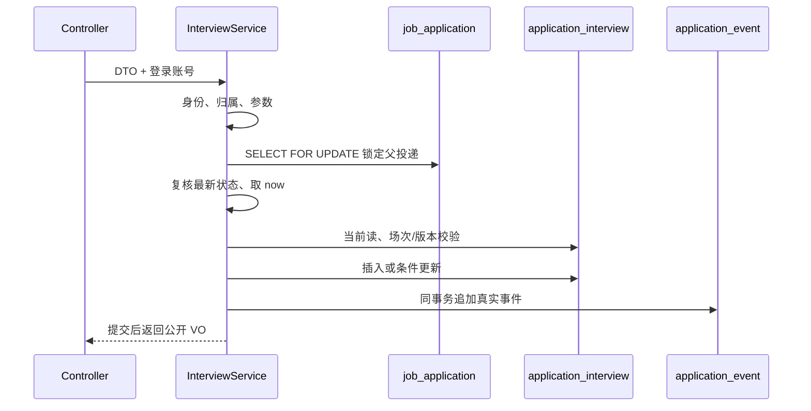

# 我的投递升级：阶段四面试排期与终态联动

日期：2026-10-25。状态：实现、编译与本轮隔离回归完成。
阶段四 224 次请求/394 条断言，旧功能复跑 135 次请求/230 条断言，全部通过；
具体范围与限制见 [阶段四验收记录](application-upgrade-phase-4-regression-2026-10-25.md)。

## 1. 业务目标、模块与交付物

企业先将投递推进到 INTERVIEW，再将沟通好的真实时间写入系统。求职者读取本人的安排，
查看近期面试并据此在前端添加日历。到期只表示 EXPIRED，不表示参加或完成。

本阶段交付：3 个 DTO、校验常量、排期实体、内部取消来源枚举、3 个包装/展示 VO、
排期 Mapper / Service / Controller、事件扩展、终态联动组件和共享时间状态组装。
新增接口 5 个，增强原投递状态更新接口。复用阶段二表结构，没有再次迁移或回填旧数据。
前端、通知、会议平台集成、求职者确认邀请不在本阶段。

工作区为 D:\project\smart-recruit；保留既有未提交改动，不提交或推送 Git。

## 2. 接口表

| 请求 | 请求参数 | data | 权限 |
| --- | --- | --- | --- |
| GET /application/{id}/interviews | 投递 ID | ApplicationInterviewListVO | 所属已审核企业 |
| POST /application/{id}/interviews | ApplicationInterviewCreateDTO | ApplicationInterviewVO | 所属已审核企业，投递 INTERVIEW |
| PUT /application/{id}/interviews/{interviewId} | ApplicationInterviewUpdateDTO | ApplicationInterviewVO | 所属企业、场次属于路径投递，尚未开始 |
| PUT /application/{id}/interviews/{interviewId}/cancel | ApplicationInterviewCancelDTO | null | 所属企业、场次有效未结束 |
| GET /application/mine/interviews/next | 无 | MyNextInterviewVO，允许 interview=null | 当前求职者 |
| PUT /application/{id}/status | 原 DTO 不变 | null | 原企业权限；新增自动取消联动 |

Result 沿用成功业务码 200、普通拒绝业务码 500/data=null、未登录 HTTP 401。
企业刷新页面可通过列表取回真实场次 ID 和版本，不能依赖上一次创建时前端保存的内存。
企业可读取任意当前状态投递的安排历史；新建、改约和手动取消要求当前 INTERVIEW。
岗位暂停、结束或原简历缺失不影响所属企业处理历史投递。

## 3. 输入校验与权限

Controller 只绑定专用 DTO，@Valid 校验非空、长度和版本；ThreadLocal 提供操作者账号 ID。
排期 DTO 拒绝未知字段，客户端不能指定归属、状态、初始版本、历史标记和取消来源。
字符串去首尾空白后，纯空白转 null；所有长度有命名常量。

时间为无 offset 的上海本地 LocalDateTime，格式 uuuu-MM-dd'T'HH:mm:ss[.SSS]。
不接收 Z、+08:00 混入 LocalDateTime；输入限制到毫秒，与 DATETIME(3) 精度一致。
版本只接收 JSON 整数，避免 Jackson 把 0.9 截断为合法版本 0；Long 溢出、负数及空版本拒绝。

Service 再次执行 Bean Validation，并完成跨字段业务校验：

- 持锁后取统一 Clock 的 now，新开始时间严格大于 now，结束严格大于开始。
- ONLINE 要求平台和有效 http/https URL，禁止同时带线下地址。
- OFFLINE 要求地址，禁止带平台或链接。完整改约会清除旧方式的字段和被省略的可选说明。
- URL 使用 URI 解析并检查 scheme 和 host，仅保存，不由服务端请求会议地址。
- 未开始的 SCHEDULED 可改约；未结束的有效 SCHEDULED（包含进行中）可取消。
- 取消需要原因及 version，保留旧场次；重复取消、过期操作、旧版本均明确拒绝。

Service 先检查企业角色、准入和投递关联岗位的企业归属，再进入锁定查询。
场次查询同时限定 application_id，不能把其它投递的 interviewId 填入当前路径进行修改。
求职者只能使用本人详情或近期查询，不调用企业安排列表/写接口。

## 4. 事务与锁顺序

所有排期写操作和投递终态处理共用同一父行作为串行入口。
同一投递最多一场 SCHEDULED 且 end_time>now 的有效安排：创建前在持有父行锁时查询，
正在进行也算有效，不能靠唯一索引(application_id,status)实现，因为那会误伤多个取消/过期历史。
普通 RR 快照可能早于另一事务提交，判断有效场次与版本使用 FOR UPDATE 当前读。
锁定查询清理会话缓存并禁用查询缓存，不能用旧实体替代数据库当前读。

改约和取消同时保留 SQL 的 id、application_id、原 version、原状态及时间条件，影响行数必须为 1。
成功版本由数据库 version+1，响应返回新版本；发生冲突不会自动刷新版本后覆盖重试。
读列表和近期查询使用只读 RR 事务，每次响应使用一个 now；写入不依赖客户端时钟。

## 5. 终态联动为什么需要独立组件

ApplicationServiceImpl 先持锁、校验并更新投递，再调用 ApplicationInterviewLifecycle.onStatusChanged。
该组件与事件组件均为 MANDATORY，必须加入业务事务，不允许独立提交。

步骤：

1. 若目标 HIRED/REJECTED，锁定该投递所有 SCHEDULED 且 end_time>now 的场次，按 ID 排序。
2. 取得全部排期锁后追加真实 STATUS_CHANGED，保持父投递、排期、事件的锁顺序。
3. 逐场取消、版本递增、来源 APPLICATION_STATUS，原时间和方式保留。
4. 每场追加 INTERVIEW_CANCELLED，actorType=SYSTEM，原因固定“投递流程已结束，安排失效”。
5. 任意场次更新或事件保存失败，投递、面试证据、所有场次/版本以及已写事件一起回滚。

已过期或此前取消的场次不修改；当前进行中场次同样失效，但不据此宣称候选人未参加过。
自动事件内部保留触发终态的真实操作者账号，仅对外显示 SYSTEM，不返回内部账号 ID。
独立组件没有反向依赖 ApplicationService，避免服务间循环依赖。

## 6. 真实事件与隐私

APPLIED/STATUS_CHANGED 沿用阶段三。新增三种排期事件，fromStatus/toStatus 均为空。

| 事件 | 时间快照 |
| --- | --- |
| INTERVIEW_SCHEDULED | startTime、endTime、mode |
| INTERVIEW_RESCHEDULED | previousStartTime/EndTime/Mode 与新的 startTime/EndTime/mode |
| INTERVIEW_CANCELLED | 原场次时间、方式及 cancelReason |

快照只序列化 InterviewChangeVO 七个白名单字段，不复制会议链接、地址、候选人说明或内部账号。
改约前先复制旧实体，再改变字段；不能在更新后读取同一个可变对象冒充旧快照。
求职者详情沿用严格白名单反序列化，不直接返回 detail_json。
ApplicationInterviewVO 只供授权双方读取，实体的 createdBy/updatedBy/cancelSource 不对外返回。
MyNextInterviewItemVO 仅补当前岗位/企业展示字段，不表示投递时快照。
旧 historyRecordedFromStart 不因新增排期或事件变成 true，不补造旧 APPLIED。

## 7. 近期面试与时间派生状态

Mapper 限定 a.user_id、投递当前 INTERVIEW、场次 SCHEDULED 且 end_time>now，
按 start_time ASC、id ASC 取第一条。岗位/企业仅 LEFT JOIN 展示，不用它们当前的公开状态排除既有安排。
近期卡片不受列表的关键词、日期和状态筛选影响；无安排时仍返回 serverTime、timeZone 和 interview=null。

ApplicationInterviewViews 统一为企业列表、创建/改约响应、求职者详情和近期面试派生状态：
先判断 CANCELLED，再按 now 与 start/end 比较得到 UPCOMING、ONGOING、EXPIRED。
相等开始时间为 ONGOING，相等结束时间为 EXPIRED。没有 COMPLETED 推断。

## 8. 验收与面试考点

验收重点：所有权限边界、在线/线下完整替换、版本冲突、历史场次、过去/相等/跨日时间、
真实旧快照、近期排序和身份隔离、任意事件失败的整体回滚、多个重叠请求下无重复有效场次或终态有效安排。
回归只能通过 Postman MCP，持久加入 SmartRecruit API - Optimized Regression，故障和并发在隔离库进行。

需要掌握：为什么锁父行、为什么保留 version 条件、为什么 RR 普通读不够、锁顺序与死锁、
MANDATORY 与 REQUIRES_NEW 的区别、同事务多表回滚、事实历史与可变排期、时间派生状态不等于出席证据。
本轮实现及回归均已完成，可按验收记录表达成果，不能据双请求竞争推导性能或规模提升。
